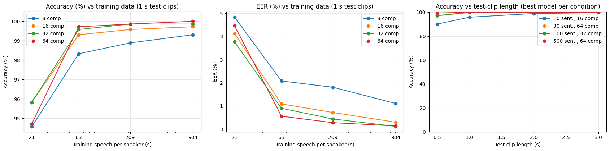
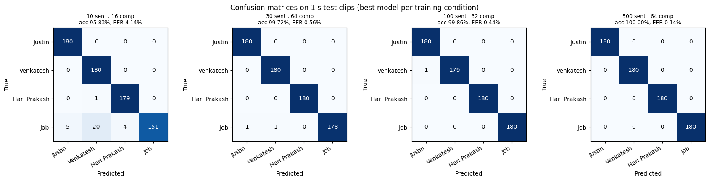

# Speaker Identification with Gaussian Mixture Models (trained from scratch)

Closed-set, text-independent speaker identification for 4 speakers. One GMM is trained per speaker on MFCC features, and a test utterance is assigned to the speaker whose GMM gives it the highest average log-likelihood.

**Speakers:** Justin (spk01) · Venkatesh (spk02) · Hari Prakash (spk03) · Job (spk04)

**Notebook:** [`gmm_speaker_id.ipynb`](gmm_speaker_id.ipynb), which covers the full pipeline, all experiments, figures and a live microphone demo. Embedded audio players were removed from the saved outputs.

### Key result
| Training data per speaker | Accuracy (1 s clips) | EER (1 s clips) |
|---|---|---|
| 100 sentences (209 s of speech) | 99.86 % | 0.44 % |
| ≈500 sentences (904 s of speech) | **100.00 %** | **0.14 %** |

## Repository files
| File | Contents |
|---|---|
| `README.md` | This file: method, parameter choices, results, discussion |
| `gmm_speaker_id.ipynb` | Full pipeline and live microphone demo (Google Colab) |
| `gmm_best_model.joblib` | Saved best model: 64-component GMMs for all 4 speakers |
| `gmm_results.csv` | All results: 16 configurations × 4 test-clip lengths |
| `gmm_curves.png`, `gmm_confusion_matrices.png` | Result figures |
| `data_summary.txt` | Per-speaker data statistics printed by the notebook |
| `master_sentences.csv` | Harvard sentence prompts with train/test split |
| `record.py` | Records one sentence at a time |
| `split_long.py` | Splits a single long recording into sentences |
| `requirements.txt` | Python dependencies |

## Dataset
- **4 speakers**, English, about 500 phonetically balanced **Harvard sentences** each (see [Dataset details](#dataset-details)).
- Laptop microphones in a quiet room. Two speakers recorded one WAV per sentence; two recorded everything in a single take.
- 36–54 min of audio per speaker, which is 18–26 min of speech after silence removal:

| Speaker | Files | Total audio | Speech |
|---|---|---|---|
| Justin (spk01) | 550 | 35.7 min | 18.1 min |
| Venkatesh (spk02) | 501 | 53.7 min | 18.4 min |
| Hari Prakash (spk03) | 1 (single take) | 41.7 min | 25.6 min |
| Job (spk04) | 1 (single take) | 49.3 min | 25.5 min |

- **The audio is not included** because of its size (~800 MB) and because it contains our voices. It is available on request.

---

## 1. Method

### 1.1 Gaussian Mixture Model
Each speaker *s* is modelled as a weighted sum of *K* Gaussians over feature vectors **x**:

p(**x** | s) = Σₖ wₖ · 𝒩(**x**; **μ**ₖ, **Σ**ₖ),  with Σₖ wₖ = 1

- Each component captures one region of the speaker's acoustic space (roughly a class of sounds), so the mixture models the speaker's overall spectral distribution, which reflects vocal-tract shape.
- **Diagonal covariances** are used (see 1.4).
- **Training:** Expectation-Maximisation (EM), initialised with k-means. In the E-step, each frame is softly assigned to the components (responsibilities). In the M-step, weights, means and variances are re-estimated. The log-likelihood never decreases between iterations.
- **Identification:** for a test clip with frames **x**₁…**x**_T, ŝ = argmax_s (1/T) Σₜ log p(**x**ₜ | s), the Bayes decision with equal priors and independent frames. The model never uses the words spoken, so it is **text-independent**.

### 1.2 Pre-processing
| Step | Setting | Reason |
|---|---|---|
| Resampling | 16 kHz, mono (`scipy.signal.resample_poly`) | Speaker information lies mainly below 8 kHz. 16 kHz is the standard rate for speaker recognition. The polyphase filter includes anti-aliasing. |
| Silence removal | 20 ms frames; drop frames with RMS < 0.1 × the 95th-percentile RMS of that recording | Silence and background noise carry no speaker information and would waste mixture components. A threshold relative to each recording copes with different recording levels. |

### 1.3 Features: MFCC + Δ + ΔΔ (60-dimensional)
| Step | Setting | Reason |
|---|---|---|
| Pre-emphasis | y[n] − 0.97·y[n−1] | Compensates the spectral tilt of voiced speech so higher-frequency detail is not swamped. |
| Framing | 25 ms Hamming window, 10 ms hop | Speech is quasi-stationary over 20–30 ms. 100 frames/s. Hamming reduces spectral leakage. |
| FFT | 512 points | Next power of two above 400 samples (25 ms at 16 kHz). |
| Mel filterbank | 40 triangular filters, 20 Hz – 8 kHz | Perceptual frequency scale, finer resolution at low frequencies. |
| Log + DCT | keep 20 cepstral coefficients | The DCT decorrelates the log filterbank energies. The low-order coefficients describe the spectral envelope (vocal-tract shape). 20 rather than 13 keeps more speaker detail. |
| Δ, ΔΔ | regression window N = 2 | Adds spectral dynamics. 20 × 3 = 60 dimensions. |
| CMVN | per 3 s segment (train and test alike) | A fixed channel (microphone/room) becomes an additive offset in the cepstral domain. Mean subtraction removes it, which matters because every speaker used a different laptop. |

### 1.4 GMM settings (`sklearn.mixture.GaussianMixture`)
| Parameter | Value | Reason |
|---|---|---|
| `n_components` | 8, 16, 32, 64 | Standard power-of-two sweep, from under- to high-capacity. |
| `covariance_type` | `diag` | MFCCs are approximately decorrelated, so a diagonal model needs 120 parameters per component instead of 1,890 for a full covariance. More stable with limited data, and faster. |
| `reg_covar` | 1e-3 | Variance floor. Prevents a component collapsing onto a few frames (variance → 0, likelihood → ∞). |
| `max_iter` | 200 | Upper bound. EM converges earlier. |
| `random_state` | 0 | Reproducibility. |

### 1.5 Data split and experimental conditions
- **Test set:** the **last 180 s of speech** from each speaker, never used for training. Cut into non-overlapping clips of **0.5 s, 1 s, 2 s and 3 s** (360 / 180 / 90 / 60 clips per speaker).
- **Training:** taken from the beginning of each recording. Training amounts are defined in sentences and converted to seconds using the measured **2.09 s of speech per sentence**:

| Condition | Training speech per speaker |
|---|---|
| 10 sentences | 21 s |
| 30 sentences | 63 s |
| **100 sentences** | 209 s |
| **500 sentences** | capped at **904 s ≈ 434 sentences** (the most every speaker has after the test set is held out) |

Every speaker receives exactly the same amount of training speech in every condition.

### 1.6 Metrics
- **Identification accuracy:** the percentage of test clips assigned to the correct speaker (4-way closed set).
- **Confusion matrix:** true speaker against predicted speaker.
- **Equal Error Rate (EER):** each clip is scored as a verification trial against every speaker (1 target and 3 non-target trials per clip). Score = log-likelihood of the claimed speaker − mean log-likelihood of the other speakers. The EER is the operating point where false-acceptance rate = false-rejection rate. It remains informative when accuracy saturates at 100%.

---

## 2. Results

Full table (16 configurations × 4 clip lengths): [`gmm_results.csv`](gmm_results.csv)

### Accuracy (%) on 1 s test clips
| Training \ Components | 8 | 16 | 32 | 64 |
|---|---|---|---|---|
| 10 sent. (21 s) | 94.58 | **95.83** | **95.83** | 94.72 |
| 30 sent. (63 s) | 98.33 | 99.31 | 99.58 | **99.72** |
| 100 sent. (209 s) | 98.89 | 99.58 | **99.86** | **99.86** |
| ≈500 sent. (904 s) | 99.31 | 99.72 | 99.86 | **100.00** |

### EER (%) on 1 s test clips
| Training \ Components | 8 | 16 | 32 | 64 |
|---|---|---|---|---|
| 10 sent. (21 s) | 4.84 | 4.14 | **3.77** | 4.47 |
| 30 sent. (63 s) | 2.08 | 1.09 | 0.90 | **0.56** |
| 100 sent. (209 s) | 1.81 | 0.72 | 0.44 | **0.28** |
| ≈500 sent. (904 s) | 1.11 | 0.30 | **0.12** | 0.14 |

### 100 vs 500 sentences, best model (64 components), by test-clip length
| Test clip | 100 sent.: Acc / EER | ≈500 sent.: Acc / EER |
|---|---|---|
| 0.5 s | 97.71 % / 2.01 % | **99.31 % / 1.25 %** |
| 1 s | 99.86 % / 0.28 % | **100.00 % / 0.14 %** |
| 2 s | 100 % / 0.00 % | 100 % / 0.00 % |
| 3 s | 100 % / 0.00 % | 100 % / 0.00 % |

### Figures

*Left: accuracy against training data. Middle: EER against training data (1 s clips). Right: accuracy against test-clip length, for the best model per condition.*


*Confusion matrices on 1 s test clips for the best model in each training condition.*

---

## 3. Discussion

1. **More training data improves identification, with diminishing returns.** The largest gain is from 10 to 30 sentences (best EER 3.77% → 0.56%). Going from **100 to ≈500 sentences** still lowers EER (0.28% → 0.14% on 1 s clips) and helps most on very short clips (0.5 s accuracy 97.71% → 99.31%). With only 4 speakers, 100 sentences already gets close to the ceiling.
2. **Model size must match the amount of data.** With 21 s of training speech (≈2,100 frames), 64 components *underperform* 16–32 components (94.72% vs 95.83%). Each component has 121 parameters, so 64 components would need ≈7,700 parameters, leaving only ≈33 frames per Gaussian. This is **overfitting**. With ≥63 s, larger models keep improving, and 64 components are best at 904 s. 8 components are consistently weakest once enough data is available (**underfitting**).
3. **Longer test utterances are much easier.** The decision averages log-likelihoods over frames. 0.5 s (≈50 frames, one or two syllables) may not contain the sounds that distinguish two speakers, while ≥2 s is identified perfectly once ≥30 training sentences are available.
4. **Errors concentrate on one speaker.** With 10 training sentences, 29 of Job's 180 clips are misidentified (20 as Venkatesh), while the other speakers are almost perfect. These errors disappear with ≥30 sentences. Plausible reasons: the 21 s training excerpt comes from the start of a single long recording and may not be representative, and/or the two voices are acoustically closer.
5. **Small non-monotonic effects** (for example 3 s clips scoring below 2 s in the 10-sentence condition, or EER 0.12% vs 0.14%) are within noise: one error on 240 clips changes accuracy by 0.42%.

### Limitations
- **Channel and session effects:** each speaker used a different laptop, and two recorded in a single take. Part of what the GMM learns may be the recording setup rather than the voice. CMVN reduces but does not eliminate this.
- **Small closed set:** 4 speakers, so identification is easier than with many speakers or with unknown (open-set) speakers.
- **Same session:** training and test speech come from the same recording session.
- The sentence counts are approximate (converted using 2.09 s of speech per sentence).

### Possible improvements
GMM-UBM with MAP adaptation (better with little enrolment data), score normalisation, and i-vector / x-vector embeddings.

---

## 4. How to run (Google Colab)

1. Put the data in Google Drive:
   ```
   MyDrive/speech_assignment_data/
   ├── data/      ← spk01/, spk02/ (WAV folders), hari_prakash_audio.wav, speech_rec.wav
   └── results/   ← outputs are written here
   ```
2. Open `gmm_speaker_id.ipynb` in Colab and choose **Runtime → Run all**.
   - **First run** (≈15 min): trains and evaluates all 16 configurations, writes tables and figures to `results/`, and saves the best model as `results/gmm_best_model.joblib`.
   - **Later runs:** the saved model is loaded and Sections 5–9 are skipped.
3. **Demo (Section 10):** 10b records 6 s from the microphone and shows the predicted speaker. 10c identifies held-out test clips.

**Demo without the audio data:** copy [`gmm_best_model.joblib`](gmm_best_model.joblib) to `MyDrive/speech_assignment_data/results/`, create an empty `data/` folder, and choose Run all.

**Locally:** `pip install -r requirements.txt`. The notebook's Google Drive cell (Section 1) needs replacing with local paths.

---

## Dataset details

### Speakers
| Code | Speaker | Recording format |
|---|---|---|
| spk01 | Justin | 550 individual WAV files (one per sentence) |
| spk02 | Venkatesh | 501 individual WAV files (one per sentence) |
| spk03 | Hari Prakash | one long WAV file (all sentences in a single take) |
| spk04 | Job | one long WAV file (all sentences in a single take) |

### Sentence prompts: `master_sentences.csv`
- Source: the **Harvard sentences** (IEEE "Recommended Practice for Speech Quality Measurements", 1969). These are phonetically balanced English sentences widely used in speech research.
- **550 sentences**, numbered `0001`–`0550`:
  - `0001`–`0500` (Harvard Lists 1–50): **training** sentences. `0001`–`0100` (Lists 1–10) form the **100-sentence subset**.
  - `0501`–`0550` (Harvard Lists 51–55): **test** sentences.
- Columns: `id`, `split`, `harvard_list`, `in_100_subset`, `filename`, `word_count`, `text`.
- Sentence length: 5–11 words (mean 7.9). The lists were used unfiltered, so some sentences exceed the 8-word guideline.

### Recording instructions given to all speakers
- Quiet room, laptop microphone, same setup for every session.
- Read through the sentences once before recording, to avoid hesitations.
- Leave about **1 s of silence** before and after each sentence.
- Speak naturally at a normal pace, and re-record any sentence with a stumble.
- `record.py` saves WAV, mono, 16-bit, 48 kHz. The GMM pipeline resamples all audio to 16 kHz.

### Tools

#### `record.py`: one sentence at a time
Shows each sentence, records it from the microphone, and saves it as `spkXX/spkXX_NNNN.wav`. It warns about clipping or very quiet takes, allows playback and re-recording, and resumes where you left off.
```bash
pip install sounddevice soundfile numpy
python record.py spk01            # or run it and type the speaker code when asked
python record.py spk01 --start 0250
python record.py --list-devices
```

#### `split_long.py`: split a single long recording
For speakers who recorded everything in one take. It finds the silent pauses between sentences (frame energy below a threshold relative to the speech level for at least `--min-silence` seconds) and saves each sentence as a separate file.
```bash
python split_long.py long_recording.wav spk03 [--min-silence 0.6] [--threshold 0.1]
```
*(The GMM experiments do not need this step: the GMM pipeline reads long files directly and splits them by duration.)*

---

## Loading the saved model
`gmm_best_model.joblib` (≈4.3 MB) holds 64-component diagonal GMMs for spk01–spk04, trained on 904 s of speech per speaker, plus 5 held-out 3 s clips per speaker for the backup demo.
```python
import joblib
bundle = joblib.load('gmm_best_model.joblib')
models, labels = bundle['models'], bundle['labels']   # dict of sklearn GaussianMixture, list of speaker codes
```
Features must be computed exactly as in the notebook (16 kHz, 20 MFCC + Δ + ΔΔ, CMVN).
